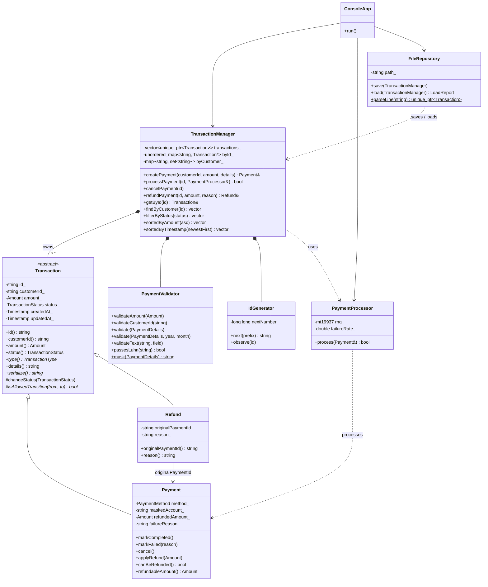
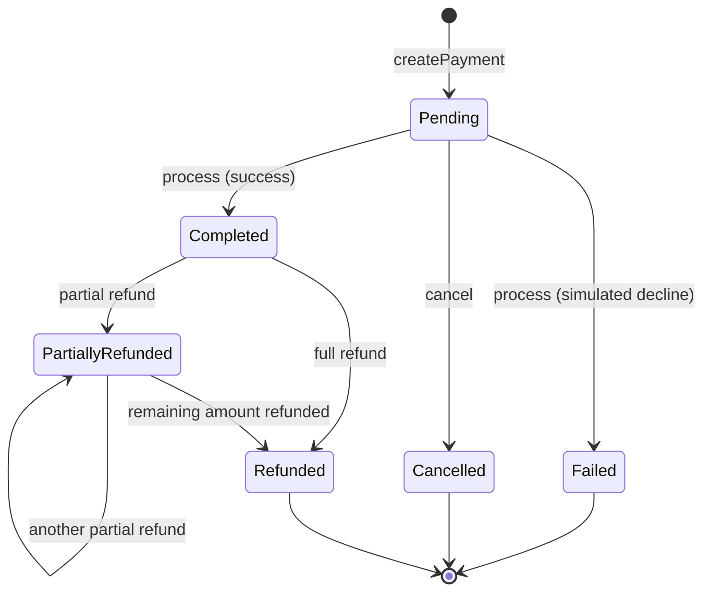

# PayCore Architecture

## 1. Requirements analysis

**Functional**

| Area | Requirement | Where it is implemented |
|------|-------------|-------------------------|
| Transactions | Create, unique IDs, status, timestamps | `TransactionManager::createPayment`, `IdGenerator`, `Transaction` |
| Validation | Amount, customer ID, card/UPI/wallet details | `PaymentValidator` |
| Processing | Confirm or fail a payment (simulated) | `PaymentProcessor::process` |
| Cancellation | Cancel only pending payments | `TransactionManager::cancelPayment`, `Payment::cancel` |
| Refunds | Full and partial, never more than paid | `TransactionManager::refundPayment`, `Payment::applyRefund` |
| History | View, search by ID/customer, filter by status, sort by amount/time | `TransactionManager` query methods |
| Persistence | Save/load, missing file, corrupted records | `FileRepository` |
| CLI | 9-option menu with input validation | `ConsoleApp` |

**Non-functional**

- Correct money handling: amounts are integers in paise, so there are no floating-point rounding errors.
- Safety: only masked account numbers are kept in memory and on disk; CVVs are never stored.
- Robustness: invalid input never crashes the program or leaves half-finished changes.
- Testability: business logic does not depend on the console; random failures can be seeded.

**Assumptions**

- Single user, single currency (INR), single process.
- A refund completes as soon as it is created.
- Customers are identified by an ID string. A separate `Customer` class would hold only that ID, so it was left out (see section 2).

## 2. Class structure

| Class | Responsibility |
|-------|----------------|
| `Transaction` (abstract) | Shared data (ID, customer, amount, status, timestamps) and the status state machine |
| `Payment` | Payment method, masked account, refunded total, failure reason; payment status rules |
| `Refund` | Link to the original payment and the reason; a refund is final |
| `PaymentValidator` | Checks all user input; masks sensitive data |
| `PaymentProcessor` | Simulated gateway: completes or fails a pending payment |
| `IdGenerator` | Unique, sequential IDs that continue after loading saved data |
| `TransactionManager` | Owns all transactions; payment operations, search, filter, sort |
| `FileRepository` | Saves and loads transactions; reports corrupted lines |
| `ConsoleApp` | Menu, input reading and output formatting only |

**Changes from the suggested class list**

- **No `Customer` class.** The project only needs a customer ID for searching. A class wrapping a single string adds code without adding behaviour. If customer profiles (name, email, saved methods) are added later, a `Customer` class would be justified.
- **Added `FileRepository`.** Keeps file handling out of `TransactionManager`, so each class has one job and persistence can be tested on its own.
- **Added `IdGenerator`** to keep the ID logic small and testable.

## 3. Class relationships

- **Inheritance:** `Payment` and `Refund` *are* transactions, so they inherit from `Transaction`. This is the only inheritance in the project; nothing else has a real "is-a" relationship.
- **Composition:** `TransactionManager` *owns* its transactions (`std::unique_ptr`), a `PaymentValidator` and an `IdGenerator`.
- **Association:** a `Refund` refers to its `Payment` by ID, not by pointer. This keeps saving and loading simple.
- **Dependency:** `TransactionManager::processPayment` uses a `PaymentProcessor` passed in by reference, so tests can pass a processor that always succeeds or always fails.
- `ConsoleApp` uses the manager, processor and repository but owns none of them; `main` creates them all.

## 4. UML class diagram

(GitHub renders Mermaid diagrams automatically. In VS Code, use a Mermaid preview extension.)

### Payment status state machine

## 5. Data structure choices

| Container | Used for | Why |
|-----------|----------|-----|
| `std::vector<std::unique_ptr<Transaction>>` | Owning all transactions | Keeps creation order for the history view; `unique_ptr` is required because the objects are polymorphic (`Payment`/`Refund`) and gives automatic cleanup |
| `std::unordered_map<std::string, Transaction*>` | Lookup by ID | Average O(1) lookup; used by every process/cancel/refund/search-by-ID operation. Order is not needed here |
| `std::map<std::string, std::set<std::string>>` | Customer → their transaction IDs | `map` keeps customers sorted; `set` stores each ID once, in sorted order, so a customer's results come back in a predictable order without extra sorting |
| `std::vector<const Transaction*>` | Query results | Cheap to copy (pointers only), easy to sort, and `const` stops callers from changing transactions through query results |
| `std::vector<std::string>` | Decline reasons, load errors | Simple ordered list |

**Algorithms:** `std::stable_sort` (sorting keeps creation order for equal keys, so results are predictable),
`std::copy_if` (status filter), `std::transform` (building the history view), reverse iterators in the Luhn check.

**Why the indexes hold raw pointers:** the vector owns every object through `unique_ptr`; the maps only *refer* to them.
Objects are never removed individually, and `clear()` empties the indexes and the vector together, so the pointers never dangle.

## 6. C++ concepts and where they appear

| Concept | Example |
|---------|---------|
| Classes, objects | Every class in `include/paycore/` |
| Constructors / delegating constructors | `Payment` "new" constructor delegates to the "restore" constructor |
| Destructors | `virtual ~Transaction()`, needed because objects are deleted through base-class pointers |
| Access modifiers | Private data members; `protected` `changeStatus` and `isAllowedTransition` for derived classes only |
| Inheritance | `Payment` and `Refund` derive from `Transaction` |
| Virtual functions / runtime polymorphism | `type()`, `details()`, `serialize()`, `isAllowedTransition()`; `FileRepository::save` calls `serialize()` on base-class pointers |
| Pure virtual / abstract class | `Transaction` cannot be created directly |
| Function overloading | `toString(TransactionType/TransactionStatus/PaymentMethod)`; `PaymentValidator::validate(details)` and `validate(details, year, month)` |
| References | Manager returns `Payment&`/`Refund&`; processor takes `Payment&` |
| Const correctness | All query methods are `const`; results are `const Transaction*` |
| Smart pointers | `std::unique_ptr` for ownership and `std::make_unique` |
| RAII | `std::ofstream`/`std::ifstream` close themselves; test fixture creates and deletes a temp folder |
| Exceptions | Hierarchy in `Exceptions.h`; strong guarantee in refunds (validate before changing state) |
| File streams | `FileRepository` with `<fstream>` and `<filesystem>` |
| Deleted copy operations | `Transaction` and `TransactionManager` cannot be copied by accident |
| `dynamic_cast` | Safe downcast from `Transaction` to `Payment` in the manager |

## 7. Key design decisions

1. **Money as integer paise** (`Amount = int64_t`). `0.1 + 0.2` is not exactly `0.3` in floating point; integer paise are exact.
2. **The status rules live in the classes.** `changeStatus` asks the derived class if a transition is allowed, so an invalid state change throws instead of corrupting data.
3. **Validate first, then change.** `refundPayment` checks the reason and amount before changing anything, so a failed refund leaves no partial changes.
4. **Atomic save.** Data is written to `transactions.csv.tmp` and then renamed over the real file, so a crash cannot leave a half-written file.
5. **Load what can be loaded.** Bad lines are skipped and reported with their line number rather than stopping the program.
6. **Injectable randomness.** `PaymentProcessor` takes a failure rate and seed, so tests can force success or failure.
7. **UI separated from logic.** `ConsoleApp` takes streams as parameters and contains no business rules.
